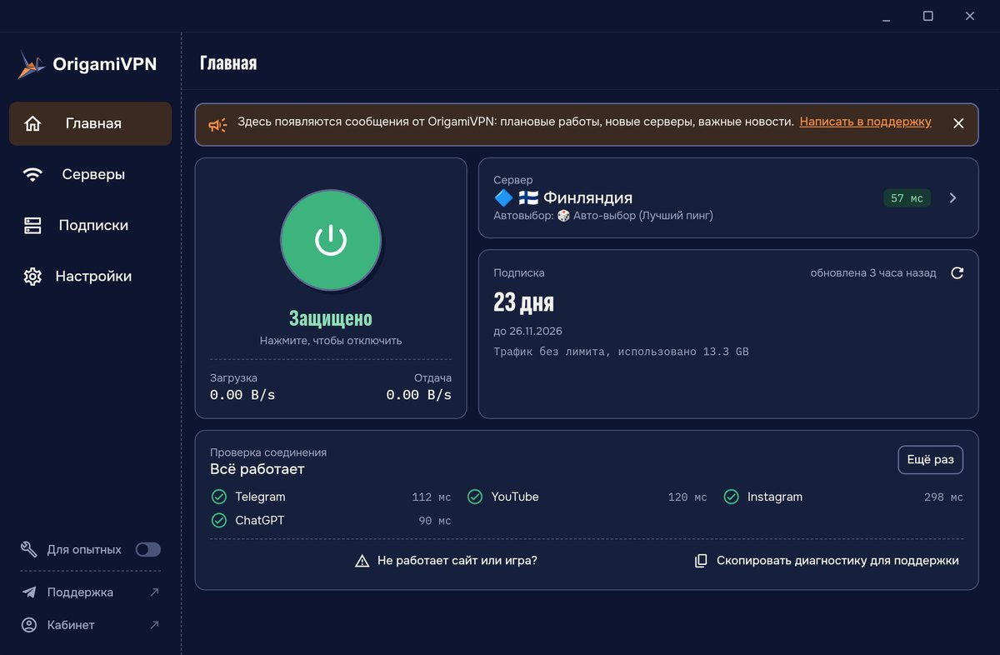
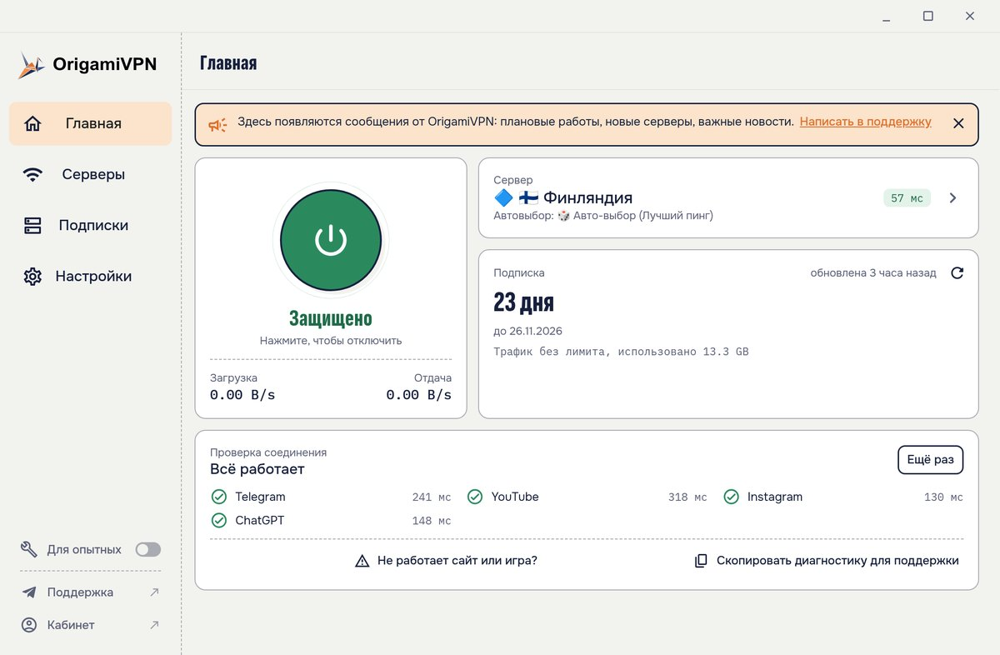
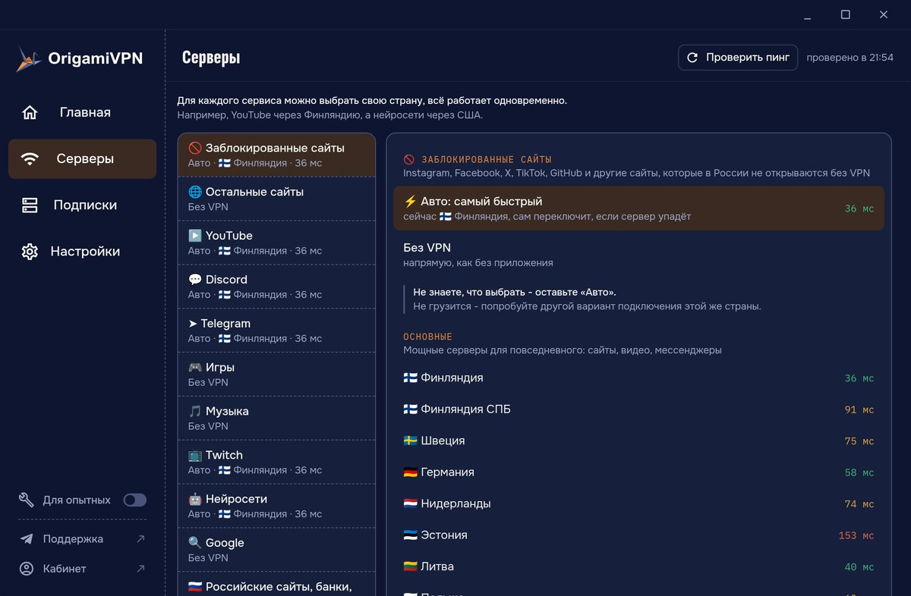
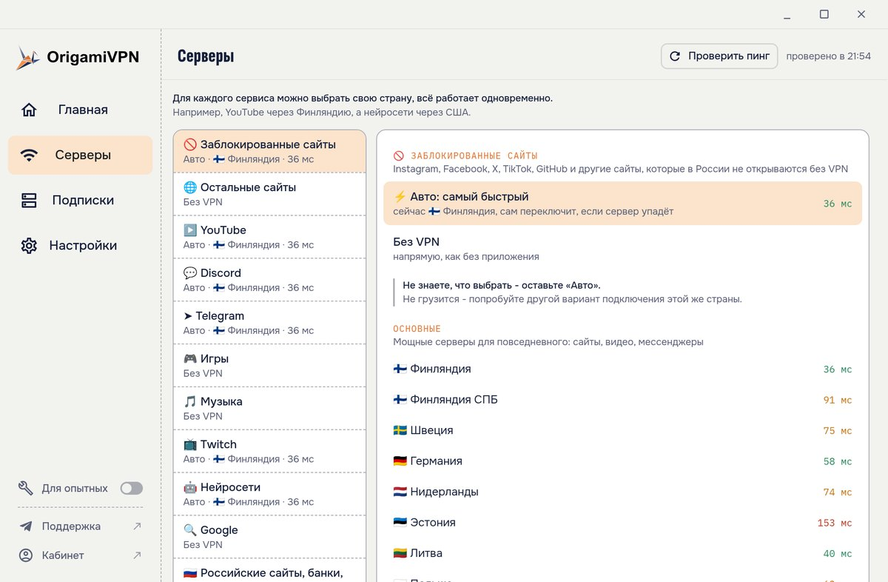
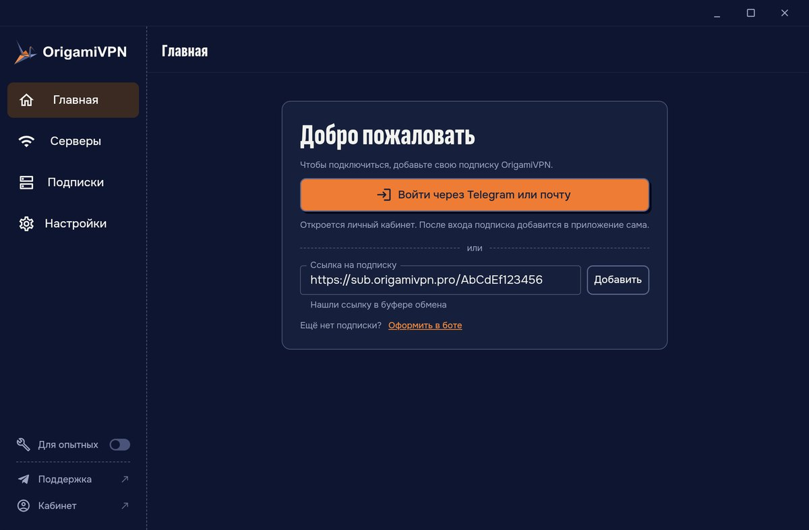

<h1 align="center">
  
  <br>
  OrigamiVPN
</h1>

<h3 align="center">
Приложение OrigamiVPN для Windows и Linux
</h3>

<p align="center">
  <a href="https://github.com/Origamidnd/origami-client/releases/latest"><b>Скачать</b></a> ·
  <a href="https://origamivpn.pro">Сайт</a> ·
  <a href="https://t.me/origamivpn">Канал</a> ·
  <a href="https://t.me/Origami_Dragons">Поддержка</a>
</p>

Одна кнопка, чтобы подключиться. Подписка добавляется сама после входа в личный кабинет, серверы и правила уже настроены, в настройки лезть не нужно.

| Тёмная тема                                   | Светлая тема                                    |
| --------------------------------------------- | ----------------------------------------------- |
|  |  |
|     |     |

## Скачать

Последняя версия всегда на [странице релизов](https://github.com/Origamidnd/origami-client/releases/latest).

| Система                    | Файл                                       |
| -------------------------- | ------------------------------------------ |
| Windows 10 и 11 (64-бит)   | `OrigamiVPN_<версия>_x64-setup.exe`        |
| Ubuntu, Debian, Linux Mint | `OrigamiVPN_<версия>_amd64.deb`            |
| Fedora                     | `OrigamiVPN-<версия>-1.x86_64.rpm`         |
| Arch, CachyOS, Manjaro     | `origamivpn-<версия>-1-x86_64.pkg.tar.zst` |

Файлы `.sig` и `latest.json` нужны программе для автообновления, скачивать их не надо.

**Windows.** Установщик сам поставит службу, она нужна, чтобы через VPN шёл весь трафик компьютера. Если стоит Clash Verge, установщик предложит его удалить: у программ общая служба. При первом запуске SmartScreen может предупредить о неизвестном издателе: «Подробнее» - «Выполнить в любом случае».

**Linux.** Пакет ставит службу вместе с программой и спросит пароль администратора. Вместе с Clash Verge не устанавливается.

**Arch Linux и производные.** Установка: `sudo pacman -U origamivpn-<версия>-1-x86_64.pkg.tar.zst`. Обновляется так же: скачайте новый пакет и поставьте его этой командой, встроенное автообновление для pacman выключено.

## Как подключиться



1. Откройте OrigamiVPN и нажмите «Войти через Telegram или почту».
2. Войдите в личный кабинет. Браузер спросит, открыть ли ссылку в приложении: разрешите, подписка добавится сама.
3. Нажмите большую кнопку «Подключить».

Можно и без кабинета: скопируйте ссылку подписки из бота или кабинета и вставьте её на первом экране.

Нет подписки? Оформите в [боте](https://t.me/origamivpn_app_bot).

## Что умеет

- **Весь компьютер через VPN.** Браузер, игры, Discord, мессенджеры. По умолчанию включён режим TUN.
- **Сервер в один клик.** Страна и пинг на главном экране, список серверов по нажатию.
- **Своя страна для каждого сервиса.** Например, YouTube через Финляндию, а нейросети через США. У каждой категории написано, что в неё входит.
- **Самый быстрый вариант сам.** Внутри страны программа переходит на другой вариант подключения, если текущий перестал отвечать или стал заметно медленнее. Нажмите на вариант, чтобы закрепить его.
- **Подписка на виду.** Сколько дней осталось и сколько трафика использовано, обновление одной кнопкой, напоминание перед окончанием.
- **Проверка соединения.** После подключения программа сама проверяет, открываются ли Telegram, YouTube, Instagram и ChatGPT.
- **Не работает сайт или игра?** Программа минуту записывает, куда обращается нужная игра или сайт, и после вашего подтверждения отправляет это мне. Я добавляю правила, обновление приходит само.
- **Помощь в один клик.** Кнопка «Скопировать диагностику для поддержки» собирает отчёт без ссылки на подписку и открывает чат поддержки.
- **Сообщения от OrigamiVPN.** Плановые работы и новости прямо на главном экране.
- **Значок в трее.** Журавлик цветной с зелёной точкой, когда VPN включён, и серый, когда выключен. Правой кнопкой - подключить или отключить, не открывая окно.
- **Автообновления.** Новая версия скачивается в фоне и ставится при следующем запуске. Все сборки подписаны, программа ставит только обновления с правильной подписью.
- **Для опытных.** Режимы подключения, правила, журналы, соединения и все настройки ядра Mihomo спрятаны за одним переключателем.

## Какие данные уходят на сервер OrigamiVPN

При обновлении подписки программа передаёт идентификатор устройства (хеш системного ID компьютера, сам ID не передаётся), название и версию системы и имя компьютера. Это нужно, чтобы считать устройства по лимиту подписки: их видно и можно удалить в личном кабинете. Если вы сами отправите отчёт «Не работает сайт или игра?», уйдут названия отмеченных программ, адреса, к которым они обращались, и через какой сервер шло. Перед отправкой программа показывает, что уйдёт. Других данных о вас и компьютере на сервер OrigamiVPN программа не передаёт.

Проверка соединения через VPN открывает сами проверяемые сервисы и один из публичных сервисов определения IP, чтобы показать страну выхода. Обновления программа проверяет и скачивает с GitHub.

## Для разработчиков

OrigamiVPN - форк [Clash Verge Rev](https://github.com/clash-verge-rev/clash-verge-rev) на [Tauri](https://tauri.app) с ядром [Mihomo](https://github.com/MetaCubeX/mihomo). Что изменено, как подтягивать обновления Clash Verge Rev и как выпускать версии: [ORIGAMI.md](./ORIGAMI.md).

```bash
pnpm i
pnpm run prebuild x86_64-unknown-linux-gnu
pnpm exec tauri dev -f verge-dev,dev-sidecar
```

## Лицензия

GPL-3.0, как и у Clash Verge Rev: исходный код открыт, см. [LICENSE](./LICENSE).

Спасибо авторам [Clash Verge Rev](https://github.com/clash-verge-rev/clash-verge-rev), [Clash Verge](https://github.com/zzzgydi/clash-verge), [Mihomo](https://github.com/MetaCubeX/mihomo) и [Tauri](https://github.com/tauri-apps/tauri).
